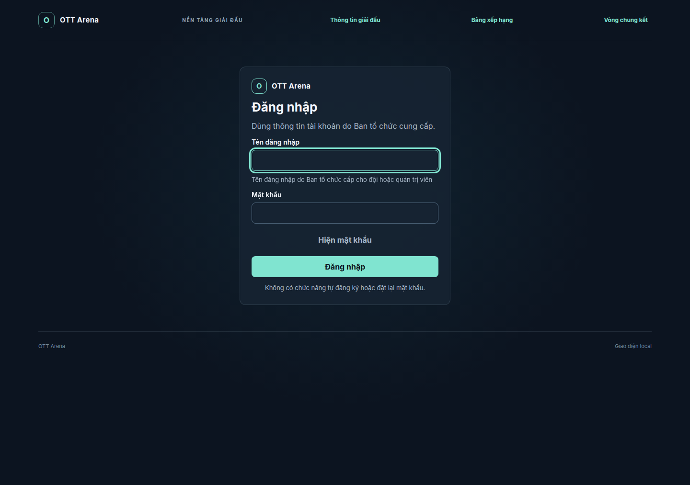
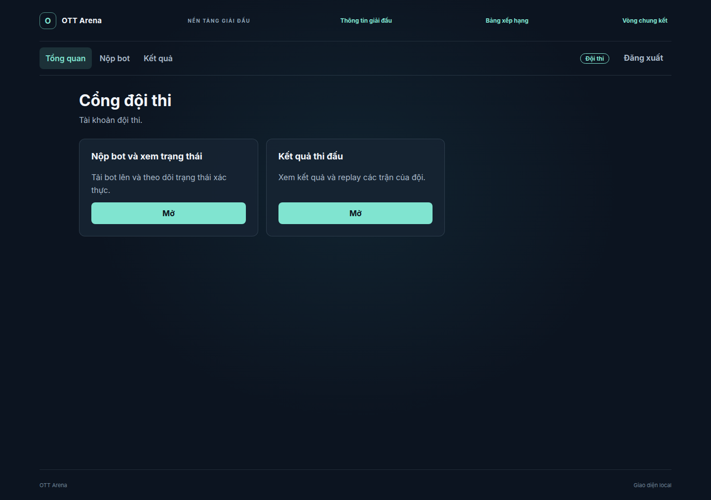
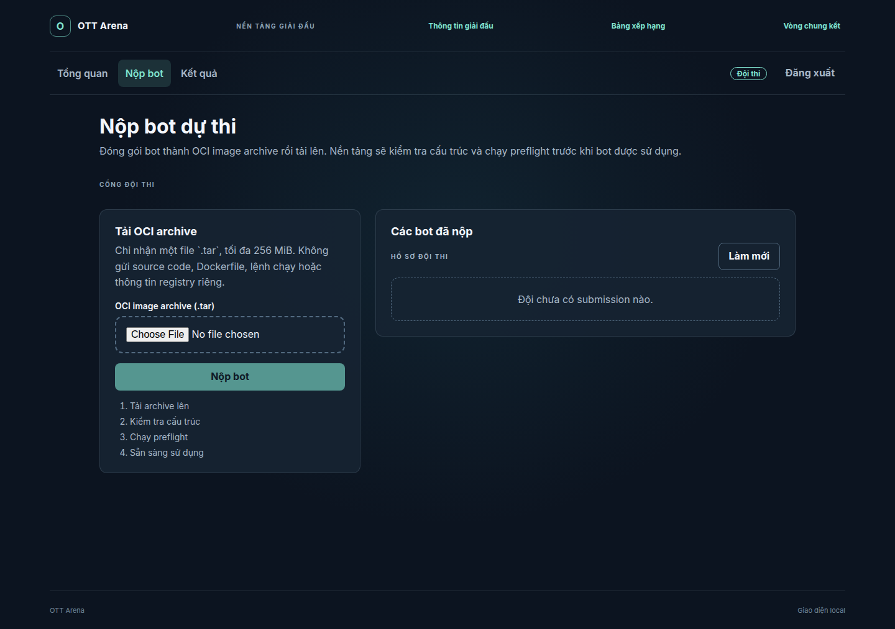
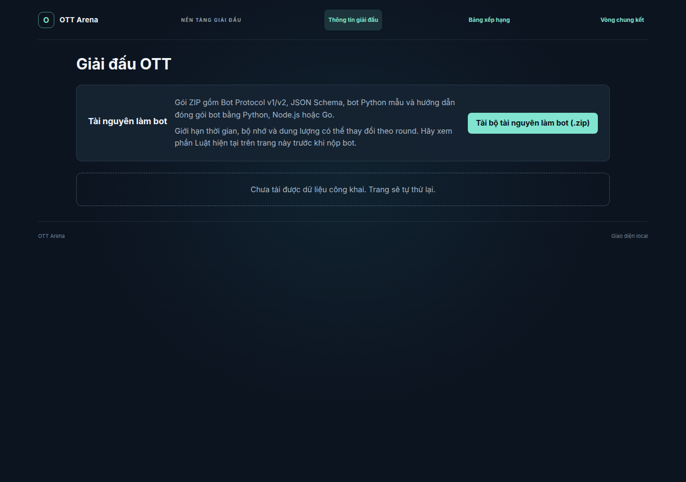
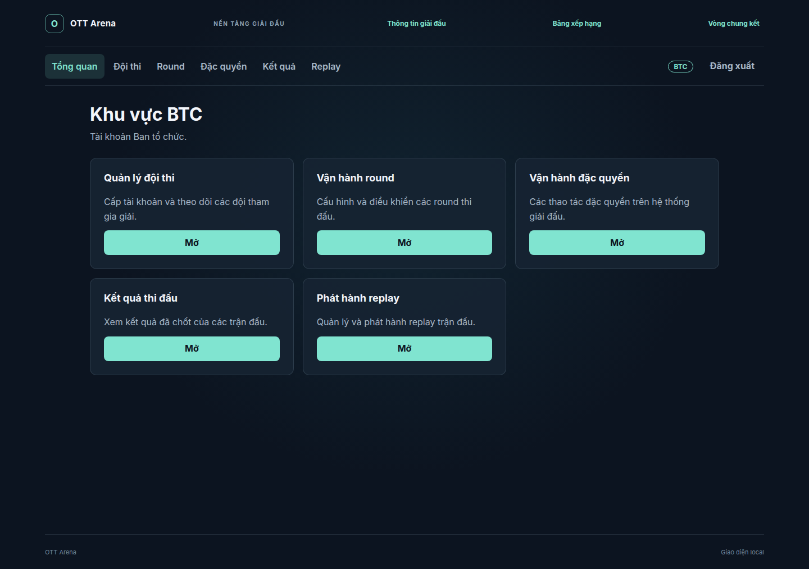
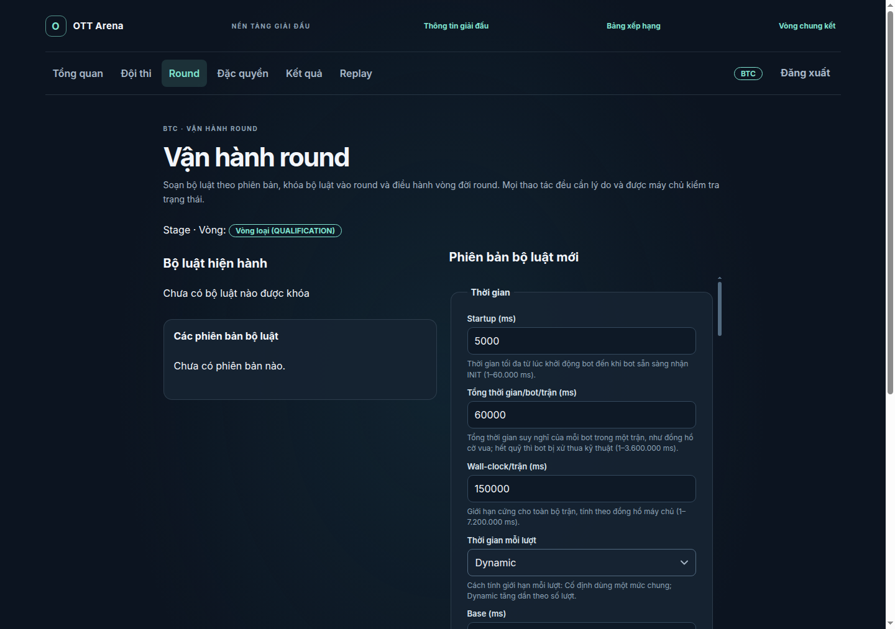

# Bản đồ chức năng trên giao diện

Tài liệu này trả lời câu hỏi: “Mỗi việc trong cuộc thi nằm ở đâu trên giao diện?”

> Ảnh bên dưới được chụp trực tiếp từ Frontend local của ứng dụng, với dữ liệu demo. Chúng minh họa giao
> diện hiện có, không phải bản thiết kế giả.

## 1. Ba khu vực giao diện

| Người dùng | Khu vực | Mục đích |
| --- | --- | --- |
| Đội thi | **Cổng đội thi** | Nộp bot, xem trạng thái, kết quả và replay riêng. |
| Ban tổ chức | **Khu vực BTC** | Cấp tài khoản, cấu hình round, xử lý thao tác đặc quyền, xem kết quả và phát hành replay. |
| Khán giả | **Trang công khai** | Xem thông tin giải, bảng xếp hạng, chung kết và replay đã được công bố. |

## 2. Đội thi: bắt đầu từ đâu?

### 2.1 Đăng nhập

**Màn hình:** trang `/` → “Đăng nhập”.

Đội dùng tên đăng nhập và mật khẩu do Ban tổ chức cấp. Trên màn hình này không có nút tự đăng ký hoặc tự
đặt lại mật khẩu; nếu mất mật khẩu, đội phải liên hệ Ban tổ chức.

### 2.2 Trang chủ đội thi

**Màn hình:** `/team` → “Cổng đội thi”.

Trang này hiện có hai lối vào:

- **Nộp bot và xem trạng thái**: đi tới màn hình upload bot.
- **Kết quả thi đấu**: xem kết quả và replay thuộc đội mình.

### 2.3 Nộp bot và theo dõi kiểm tra

**Màn hình:** `/team/submissions` → “Nộp bot dự thi”.

Đây là mapping trực tiếp cho các bước “tạo gói bot” và “nộp bot”:

| Việc của đội | Thành phần trên UI hiện có |
| --- | --- |
| Chọn gói bot đã đóng gói | Ô chọn file **OCI image archive (.tar)** |
| Gửi bot | Nút **Nộp bot** |
| Theo dõi quá trình tải | Thanh tiến trình và thông báo chờ lượt tải |
| Biết bot đạt hay chưa | Khung **Các bot đã nộp** với trạng thái: đã tải, đang kiểm tra, không hợp lệ, chờ kiểm tra bot, hợp lệ, đang sử dụng… |
| Biết vì sao không nộp được | Thông báo lỗi rõ ràng: quá hạn, file khác với file đã giữ chỗ, quá dung lượng, hệ thống đang bận… |

## 3. Nội dung hỗ trợ người viết bot nằm ở đâu?

Đoạn “Ban tổ chức cung cấp tài liệu, bot mẫu, bộ khởi tạo và quy định tài nguyên” được mapping vào trang
công khai `/public`. Người dùng không cần đăng nhập để tải tài nguyên.

| Nội dung đội cần | Mapping hiện tại | Trạng thái |
| --- | --- | --- |
| Luật của round: thời gian, bộ nhớ, dung lượng, bản đồ | Trang công khai `/public`, phần **Luật hiện tại**; BTC soạn tại `/admin/rounds` | Đã có UI |
| Tài liệu bot nhận bàn cờ và gửi nước đi | `/public` → **Tài nguyên làm bot** → **Tải bộ tài nguyên làm bot (.zip)** | Đã có nút tải |
| Bot mẫu để tham khảo | Cùng gói ZIP: Python, Node.js và Go | Đã có nút tải |
| Bộ khởi tạo theo ngôn ngữ | Cùng gói ZIP: mã mẫu và hướng dẫn đóng gói OCI cho Python/Node.js/Go | Đã có nút tải |
| Chạy thử bot | Có trong yêu cầu sản phẩm, nhưng chưa thấy route/menu riêng trong Frontend hiện tại | Chưa có UI riêng |

Nói ngắn gọn: trang `/public` là nơi tải tài nguyên và đọc luật; màn hình **Nộp bot** chỉ nhận file sản
phẩm đã đóng gói.

### Phần vẫn chưa có UI

Frontend vẫn chưa có nút **Chạy thử bot** và lịch sử các lần chạy thử. Đây là yêu cầu tương lai, không phải
chức năng của nút tải tài nguyên.

## 4. Ban tổ chức: chức năng nằm ở đâu?

**Màn hình:** `/admin` → “Khu vực BTC”.

| Việc của Ban tổ chức | Màn hình hiện có |
| --- | --- |
| Tạo đội, cấp/reset tài khoản | **Đội thi** → `/admin/teams` |
| Soạn luật, mở/đóng và điều hành vòng loại | **Round** → `/admin/rounds` |
| Thao tác đặc biệt, audit, hàng chờ, kiểm tra bản nộp trùng | **Đặc quyền** → `/admin/operations` |
| Xem kết quả đã chốt | **Kết quả** → `/admin/results` |
| Kiểm tra/phát hành replay | **Replay** → `/admin/replays` |

### 4.1 Soạn và điều hành round

**Màn hình:** `/admin/rounds` → “Vận hành round”.

BTC dùng màn hình này để xem bộ luật hiện hành, tạo phiên bản luật mới và điều khiển vòng đời vòng loại.
Các trường thời gian xuất hiện trực tiếp ở biểu mẫu; các giới hạn khác như bộ nhớ, CPU, dung lượng image,
bản đồ và Engine nằm ở cùng bộ luật khi cuộn tiếp hoặc mở danh mục liên quan.

## 5. Khán giả xem ở đâu?

| Nội dung | Đường dẫn công khai |
| --- | --- |
| Thông tin giải, tiến độ, hàng chờ, luật và thông báo | `/public` |
| Bảng xếp hạng đầy đủ | `/leaderboard` |
| Nhánh và kết quả chung kết | `/finals` |
| Replay chung kết đã phát hành | `/spectator/replays/:matchId` |

Khán giả không có màn hình để nộp bot, xem bot của đội khác hoặc điều khiển trận. Đây là chủ ý để bảo vệ
hệ thống và tránh lộ chiến thuật trong vòng loại.

## 6. Các phần chung kết chưa có UI vận hành riêng

Trang `/finals` đã có để hiển thị dữ liệu chung kết công khai. Tuy nhiên, trong Frontend hiện tại chưa thấy
màn hình riêng cho:

- nhận bot chung kết trong mạng nội bộ;
- khóa bot chung kết;
- tạo/gửi gói kết quả có chữ ký;
- nhập gói kết quả từ mạng chung kết lên hệ thống online.

Các việc này thuộc luồng vận hành/chuyển gói, cần được bổ sung thành UI hoặc runbook riêng trước khi dùng
cho một buổi chung kết thật.
