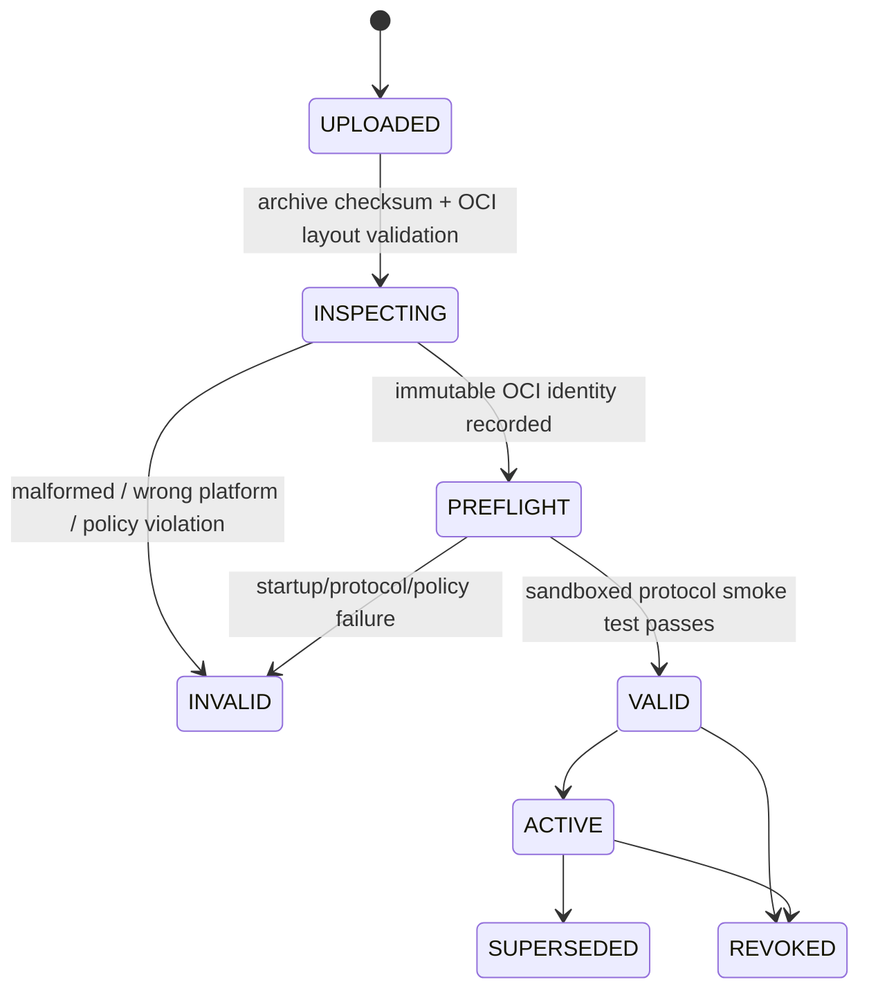
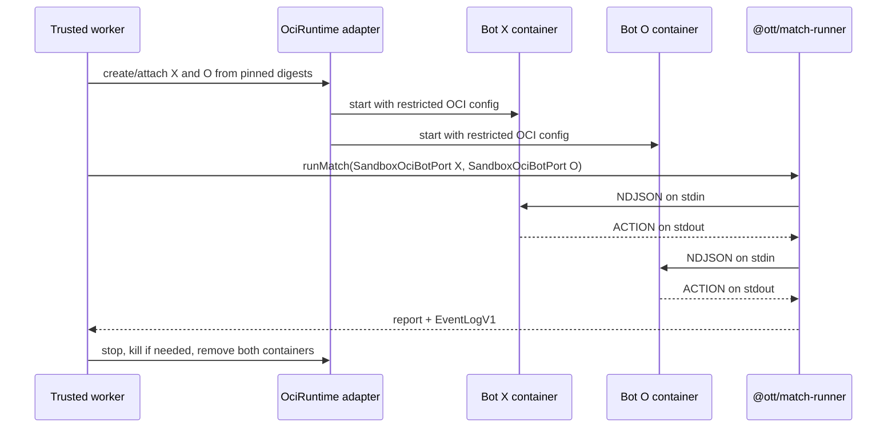

# SAD — OCI Bot Submission and Sandbox Execution

> **Status:** Accepted design baseline for Phase 2 local
>
> **Date:** 2026-10-12
>
> **Implements:** [ADR-0006](../decisions/0006-oci-image-submissions-for-language-neutral-bots.md)

## 1. Problem and goals

BTC must execute a bot written in any language without inspecting its source, choosing a language-specific launcher, or exposing a network service for the bot. The existing Bot Protocol v1 already meets this at the interaction boundary: the runner writes NDJSON to stdin and reads NDJSON from stdout. The missing boundary is a language-neutral, reproducible submission artifact.

Phase 2 local therefore accepts exactly one executable submission format: an **OCI Image Spec 1.1 image in an OCI Image Layout archive** for `linux/amd64`. The layout marker remains `imageLayoutVersion: 1.0.0` as defined by the [OCI Image Layout specification](https://github.com/opencontainers/image-spec/blob/main/image-layout.md). The archive contains the team’s runtime, dependency and optional local AI/model. Its configured OCI `Entrypoint` starts the bot. No source-language field, user-supplied shell command, HTTP port, Dockerfile or build-on-upload path is accepted.

Goals:

- preserve `@ott/bot-protocol` v1 and Phase 1 MatchRunner unchanged;
- let a bot return `ACTION` from any implementation language or local model;
- make every official execution reproducible by OCI manifest/config digest plus policy version;
- keep untrusted image code out of API, database, object-storage credentials and host network;
- use existing Python bots as the first OCI fixtures, then add cross-language fixtures without changing protocol.

Non-goals: receiving a Dockerfile, building from source on BTC infrastructure, custom network callbacks, external AI APIs, multi-architecture images or a public container registry.

## 2. Submission contract

### 2.1 What a team uploads

The multipart submission request contains one file: `bot.oci.tar`.

It is an uncompressed tar containing OCI Image Layout files (`oci-layout`, `index.json`, `blobs/sha256/...`) with marker `imageLayoutVersion: 1.0.0`. The image must resolve to exactly one manifest for `linux/amd64` and one config with a non-empty `Entrypoint`. The team chooses implementation language only inside that image.

The API does not accept or trust:

- `language`, `command`, `entrypoint`, `runtime`, `imageTag` or `teamId` supplied as request fields;
- a `Dockerfile`, compose file, image build context, registry URL or URL to fetch;
- a tag such as `latest` as an immutable identity.

The platform derives and persists `archiveSha256`, OCI manifest digest, config digest, resolved entrypoint, platform, uncompressed size and policy version. These values, not a mutable tag, are pinned to an official `Match`.

### 2.2 Team-facing protocol

Once the container starts, no language-specific protocol applies:

```text
stdin  : INIT / STATE_UPDATE / TURN_RESULT / MATCH_RESULT as NDJSON v1
stdout : exactly one ACTION NDJSON line when an action is requested
stderr : diagnostic-only, quota limited, never replayed publicly
```

The container must not open a port or wait for a network connection. A local model is allowed only when all model files are embedded in the OCI image and execution remains within the stage resource profile. Calling an external model/API is impossible in an official match because the sandbox has no egress.

## 3. Validation and lifecycle



Validation order:

1. Stream upload to a quarantine key with size cap; calculate SHA-256. No extraction or container runtime action occurs in the API request handler.
2. A validator reads the tar defensively: no traversal paths, links, device files, duplicate conflicting paths, foreign layers or file-size expansion above limits.
3. Validate OCI layout/index/manifest/config digests, require exactly `linux/amd64`, a non-empty OCI `Entrypoint`, and an image/config size inside the published policy.
4. Promote the original archive to content-addressed private storage only after structural validation. Store the derived identity transactionally.
5. In an isolated sandbox, run the preflight fixture against Bot Protocol v1. Only a bot that starts and responds with a valid `ACTION` becomes `VALID`.

`INVALID` exposes a stable, team-actionable code but never host paths, security profile details, credentials or raw worker logs. `ACTIVE` is immutable and a cutoff pins its derived digest.

## 4. Runtime design



`SandboxOciBotPort` implements the existing `BotPort` interface. It replaces Phase 1’s direct `BotProcess` only in the Phase 2 worker; `game-core`, `bot-protocol`, `runMatch` and the Phase 1 CLI are not changed.

The local adapter uses the Docker Engine HTTP API over the trusted worker's Unix
socket (API v1.41); it does not invoke a shell, Docker CLI, build, tag or
team-supplied command. Before import it checks archive SHA-256 plus the pinned
OCI manifest/config digests and derived entrypoint. After `/images/load`, Docker
`Image.Id` must equal the pinned manifest digest and inspected `Config.Entrypoint`
must equal the validated entrypoint. The worker runs by that immutable image ID
and overrides `User`, entrypoint, command, and all sandbox HostConfig fields.
The BotPort decodes Docker's multiplexed attach stream and passes only bounded
stdout NDJSON through the canonical Bot Protocol v1 schema validator; stderr is
counted but never logged or parsed as protocol.

The trusted worker owns the Docker Engine adapter in local development. Bot containers receive none of the Docker socket, PostgreSQL/Redis/SeaweedFS credentials, host mounts or browser-facing ports. Local S3 credentials are available only to the control/execution plane through environment configuration, never to bot containers. A production runtime may replace the adapter behind the same `OciRuntime` interface only through a later ADR.

## 5. Mandatory sandbox policy

The worker overrides untrusted image defaults. For each bot container it enforces:

- `linux/amd64`, non-root UID/GID, dropped capabilities and `no-new-privileges`;
- no network, no published port, no Docker socket, no host path mount and no privileged mode;
- read-only root filesystem and a fresh quota-limited `tmpfs` at `/tmp`;
- CPU, memory, PID, process-time, startup, turn, stdout and stderr limits from the versioned stage profile;
- container name/labels generated by the worker; image `Entrypoint` only, never a shell string assembled from team input;
- attach stdin/stdout before start, deterministic timeout/cleanup, then force removal of container and descendants.

`OTT_SANDBOX_V1` baseline profile is 1 vCPU, 256 MiB RAM (swap capped to the
same amount), 64 PIDs, 64 MiB `/tmp`, 5-second protocol startup baseline,
3-second turn, 64 KiB protocol message, 4 MiB cumulative stdout and 1 MiB
stderr. A memory OOM and cumulative output/stderr breach map to stable existing
protocol process faults; per-message overflow maps to `MESSAGE_TOO_LARGE`.
Turn timeout remains the protocol's recoverable `BOT_TIMEOUT`: a late reply is
discarded, the sandbox may receive later turn messages, and the container is
removed idempotently when the match lifecycle stops it.
This remains a pre-benchmark baseline: the OCI corpus must prove it before
registration opens.

## 6. Persistence and audit

`Submission` gains immutable OCI fields:

```text
artifactKind = OCI_IMAGE_LAYOUT_V1
archiveSha256
ociManifestDigest
ociConfigDigest
platform = linux/amd64
entrypoint (derived from OCI config)
policyVersion
archiveBytes / uncompressedBytes
```

The archive and every event log use server-generated content-addressed object keys. `Match` stores the submission/digests and policy version in its immutable execution snapshot. Audit records upload, validation result, activation, revoke and any BTC exception, but never archive content, bot stderr, session material or credential plaintext.

## 7. Local development and test matrix

The repository provides **trusted test fixture Dockerfiles** only for developers to build OCI test archives; teams do not upload Dockerfiles. Initial fixtures package the existing deterministic Python `first_legal_bot` and `capture_first_bot` unchanged. They establish that the old AI/strategy bot continues to operate through the OCI adapter.

The corpus includes good images for both Python bots plus Node.js and native shell canaries, and fault images for timeout, fork/PID pressure, read-only filesystem write, attempted network access, output flood, memory pressure and CPU pressure. `npm --workspace @ott/sandbox-corpus run build:corpus` exports reproducible OCI archives to the ignored `artifacts/` directory and records archive SHA-256, manifest/config digest, entrypoint and expected outcome in the checked-in manifest. Fault images must only be imported and executed by the limited sandbox harness in `P2-T10`/`P2-T15`.

## 8. Delivery tasks and acceptance gates

| Task | Deliverable | Gate |
| --- | --- | --- |
| `P2-T14` | OCI Submission Contract v1, pure layout validator and fixtures | accepts/rejects archive deterministically without Docker runtime |
| `P2-T07` | authenticated upload, quarantine/S3 promotion, immutable submission identity | team can upload only own OCI archive; no mutable tag/command accepted |
| `P2-T08` | OCI corpus built from existing Python bots first, then fault/cross-language fixtures | fixture archive checksums and expected outcomes reproducible |
| `P2-T09` | MatchJob v1 carries only pinned submission/OCI references | duplicate delivery cannot substitute another image |
| `P2-T10` | Docker-backed `SandboxOciBotPort` and policy enforcement | Python/Node/native fixtures play via unchanged MatchRunner; all fault fixtures run under inspected resource/network policy and terminate with stable Bot Protocol v1 process/recoverable faults |
| `P2-T15` | Benchmark quota and registration gate | corpus evidence locks the published profile before team submissions open |
| `P2-T11` | finalization persists log/result against pinned OCI identity | retry cannot create a second official result |

No language expansion changes Bot Protocol v1. A non-Python bot is only accepted after its OCI fixture proves the same transcript and sandbox policy.
