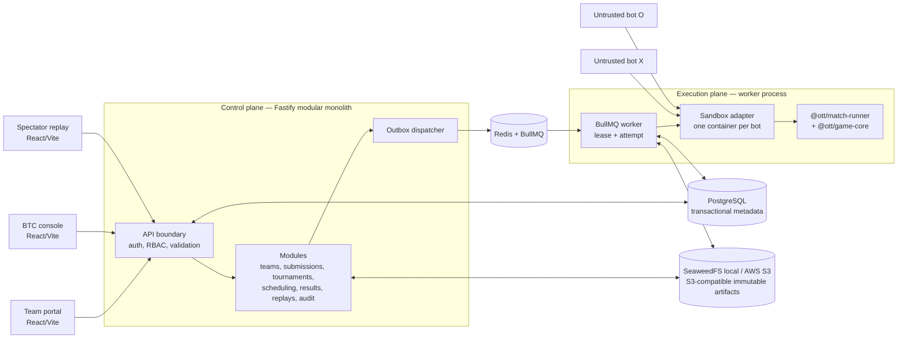

# Solution Architecture — Phase 2 local

> **Trạng thái:** Accepted architecture baseline cho `P2-T01`; resource profile vẫn cần benchmark có kiểm soát trước khi nhận submission.
>
> **Ngày:** 2026-10-12
>
> **Nguồn quyết định:** [ADR-0001](../decisions/0001-technology-stack-and-local-development.md), [ADR-0003](../decisions/0003-replay-publication-after-match.md), [ADR-0004](../decisions/0004-phase-2-team-account-authentication.md), [ADR-0005](../decisions/0005-phase-2-modular-monolith-and-execution-boundary.md).

## 1. Mục tiêu và phạm vi

Phase 2 biến các package Phase 1 đã chạy local thành nền tảng giải đấu local: đội đăng nhập/nộp bot, worker chạy trận trong sandbox, BTC vận hành kết quả và công bố replay sau khi trận đã terminal. Đây là **modular monolith control plane** kết hợp một **execution worker** riêng; không phải microservice phân tán.

Architecture này dùng code đã có làm nguồn thực tế:

- `@ott/game-core` vẫn là nguồn sự thật duy nhất cho game state, luật và hash.
- `@ott/bot-protocol` vẫn là contract NDJSON v1, không đổi field hay semantics.
- `@ott/match-runner` export công khai `runMatch`, event-log v1 và `verifyReplay`; worker gọi qua public entrypoint, không sao chép vòng lặp trận hoặc luật game.
- `src/platform/*` hiện là ranh giới Phase 2 chưa có implementation; các task `P2-T02`–`P2-T15` tạo chúng theo thứ tự bên dưới.

## 2. Bức tranh hệ thống



Control plane và execution plane có thể cùng một máy trong local development nhưng là hai process độc lập. Browser chỉ gọi control plane. Không có browser, replay UI hay bot nào kết nối trực tiếp vào worker, Docker socket hoặc sandbox.

## 3. Ranh giới module và ownership

| Package/đường dẫn | Vai trò | Không được làm |
| --- | --- | --- |
| `src/game-core` | Engine deterministic, event/state/hash | Import framework, DB, queue, Docker hay UI |
| `src/bot-protocol` | Schema/message v1 và validation | Biết database hoặc sandbox |
| `src/match-runner` | Điều phối một trận, event log và replay verification | Chứa game rules hoặc persistence Phase 2 |
| `src/platform/job-contract` | Types/schema versioned cho `MatchJob` | Import Fastify, BullMQ hoặc worker runtime |
| `src/platform/api` | Fastify control plane, DB transaction, S3 adapter, enqueue/read API | Spawn bot, chạy game loop hoặc tính result từ client |
| `src/platform/worker` | Claim job, sandbox, gọi MatchRunner, upload artifact và finalization | Quyết định pairing/Elo theo thứ tự job |
| `src/platform/web` | Portal team, BTC console, public replay/results | Giữ secret, tự authorization hoặc truy cập worker |

`api` và `worker` có thể dùng cùng PostgreSQL schema/repository primitives, nhưng không import route/service private của nhau. `job-contract` là public boundary giữa hai process. Artifact object chỉ được đọc/ghi qua storage adapter; code bot không bao giờ nhận credential storage.

## 4. Hợp đồng và luồng chính

### 4.1 HTTP control plane

- Prefix v1: `/api/v1`; request/response dùng schema runtime và response lỗi duy nhất `{ error: { code, message, details? } }`.
- API thay đổi state xác thực principal server-side và ghi `AuditEvent`; mọi list dùng pagination stable.
- `TEAM_ACCOUNT` luôn lấy `teamId` từ session, không nhận `teamId` tin cậy từ client.
- Create/reset credential là ngoại lệ one-time: plaintext chỉ nằm trong response thành công và không vào database, log, audit hay replay.
- Endpoint replay public chỉ trả replay `PUBLISHED`; endpoint BTC stage/publish đòi `BTC_ADMIN`, lý do và audit.

### 4.2 Artifact và submission

1. Team upload một OCI Image Spec 1.1 image trong OCI Image Layout archive `linux/amd64` (layout marker `1.0.0`); API không nhận language, command, runtime, Dockerfile hay tag.
2. `P2-T14` kiểm tra layout, digest, non-empty OCI `Entrypoint`, size/platform/path safety trước khi archive được promote từ quarantine sang object storage. Object chỉ là `VALID` sau protocol preflight trong sandbox.
3. Worker tải archive theo immutable manifest/config digest được pin trong `Match`, tạo container từ OCI `Entrypoint` và luôn override policy. Worker không tin filename, user command hay image tag.

### 4.3 Job và finalization exactly-once

`MatchJobV1` dùng strict allowlist với `schemaVersion`, `matchId`, `idempotencyKey=matchId`, policy version và immutable references cho từng submission (submission UUID, archive SHA-256, OCI manifest/config digest, policy version). Không có registry tag, image name hay command do client chọn. Queue dùng `jobId=match-<match UUID>`, giữ terminal job để dedupe và phát final failure đúng một lần vào dead-letter queue riêng; retry tối đa 3 lần exponential backoff bắt đầu 1 giây. Worker validate contract trước handler; malformed payload được cách ly ngay, chỉ lưu fingerprint SHA-256; logs chỉ giữ stable error code, không stdout/stderr/raw exception. Graceful close đợi active jobs. PostgreSQL giữ match status, submission identity, map definition/checksum, seed, engine và turn limits. API/job profile `P2_BASELINE_V1` được map qua allowlist tường minh sang sandbox implementation policy `OTT_SANDBOX_V1`; worker từ chối profile khác chưa đăng ký.

`P2-T11` claim khóa hàng `Match`, kiểm tra snapshot hai submission với payload, rồi append `MatchAttempt` có lease 15 phút. Match tối đa 200 turn với timeout 3 giây mỗi lượt nằm trong lease; DB trigger ngăn sửa execution snapshot sau khi tạo, lease hết hạn cho phép retry mới, attempt cũ không thể finalize. Infrastructure failure ghi stable error code và attempt retryable (lần cuối là terminal); bot fault là kết quả game hợp lệ. Worker xác minh event log bằng `verifyReplay`, upload JSON theo key chứa SHA-256, rồi transaction tạo `MatchResult`, `MatchEvent` rows, `MATCH_FINALIZED` outbox duy nhất và chuyển match sang `FINALIZED`. Redelivery sau commit trả official result hiện hữu mà không chạy bot lần nữa. Object upload trước DB commit có thể để lại object mồ côi nếu transaction lỗi; content-addressed key làm lần retry cùng bytes an toàn và outbox/DB mới là trạng thái chính thức.

```text
schedule transaction
  -> tạo Match(SCHEDULED) + outbox row unique(matchId, kind)
  -> dispatcher publish BullMQ job với jobId = matchId
  -> worker claim lease + tạo MatchAttempt
  -> validate artifact + chạy hai sandbox + MatchRunner
  -> verify event log + upload immutable log/checksum
  -> transaction có unique(matchId): MatchResult, final status, outbox result event
  -> scheduler chỉ tính series/rating từ Match FINALIZED
```

- Queue là at-least-once. Duplicate delivery, worker restart và lease hết hạn được chấp nhận, nhưng unique constraint/conditional transition là cơ chế chỉ cho một `MatchResult` chính thức.
- Infrastructure failure chuyển attempt sang retryable theo backoff/DLQ; bot fault là result hợp lệ và không retry mù.
- Rating ledger và `ratingApplied` cập nhật cùng transaction idempotent khi series đã terminal, không nằm trong worker match.

### 4.4 Replay publication

Worker chỉ upload event log sau khi `verifyReplay` pass và lưu checksum/final hash. API replay kiểm tra match `FINALIZED`, artifact checksum và publication state trước khi BTC `STAGE`/`PUBLISH`. Spectator chỉ tải representation public đã lọc; không có live feed, seed chưa công bố, source bot, stderr hay worker log.

## 5. Dữ liệu, transaction và state machine

PostgreSQL giữ metadata, relations, audit và transaction; SeaweedFS chỉ giữ object immutable local; Redis chỉ giữ cache/session/rate-limit/queue và không là nguồn lịch sử chính. API/worker dùng S3 core operations để có thể chuyển sang AWS S3 theo ADR-0007.

Các invariant bắt buộc được enforce bằng database constraint/transaction, không chỉ bằng code:

- `TEAM_ACCOUNT` 1:1 `Team`; username unique; session revocation đọc server-side.
- `Submission.sha256` và object key bất biến sau VALID; mỗi team/stage chỉ một ACTIVE submission.
- `MatchResult.matchId` unique; `Match` transition conditional theo status/lease; `MatchAttempt` append-only.
- `RatingLedger(teamId, seriesId)` unique; rating snapshot của round bất biến.
- `Replay.matchId` unique; public read chỉ sau `PUBLISHED`.
- `AuditEvent` append-only, có actor/action/target/reason/correlationId; không chứa secret.

## 6. Security architecture và trust boundaries

| Boundary | Mối đe dọa chính | Control bắt buộc |
| --- | --- | --- |
| Browser → API | credential stuffing, IDOR, XSS/CSRF | Argon2id, Redis rate-limit, opaque `HttpOnly` cookie, role + team ownership server-side, schema validation, CSP/security headers |
| Upload → storage/worker | tar traversal, decompression bomb, forged OCI digest, resource DoS | OCI layout allowlist, streaming size/path/digest validation, server key, quarantine/preflight before ACTIVE |
| Worker → bot container | escape, fork bomb, egress, host disclosure | rootfs read-only, non-root, no Docker socket/mount, no network, dropped capability/seccomp profile, CPU/RAM/PID/tmp/output/time limits, kill process group |
| API/worker → DB/queue/storage | duplicate side effect, tamper, credential leak | least-privilege credentials, TLS outside local, transaction + unique constraints, checksum, structured logs with redaction |
| Replay → public | private data/early disclosure | terminal+integrity+PUBLISHED gate, response allowlist, no direct object bucket public access |

The worker is trusted and may use the host container runtime; **a bot container never receives the runtime socket**. Shell strings are forbidden for bot command execution. Any path derived from an archive is resolved and verified under an allowlisted extraction root before use.

## 7. P2-T01 implementation decisions

| Decision | Chốt cho Phase 2 local | Consumer |
| --- | --- | --- |
| Rating | initial rating `1000`; `K = 32`; ledger per terminal series | `P2-T03`, `P2-T12`, `P2-T13` |
| Qualification series | exactly 2 games, same map/checksum and pinned submissions; X/O swap; score 1/0.5/0; equal aggregate = draw | `P2-T12`, `P2-T13` |
| Round schedule | one series/team/round; Elo band starts at 200 and expands 100 deterministically until paired; seed/snapshot freeze before enqueue | `P2-T12` |
| Runtime artifact | OCI Image Spec 1.1 in OCI Image Layout (`imageLayoutVersion: 1.0.0`), `linux/amd64`, non-empty image Entrypoint; platform derives/pins manifest+config digest and rejects Dockerfile, registry URL, tag or client command. | `P2-T03`, `P2-T14`, `P2-T07`, `P2-T10` |
| Baseline resource profile | startup 5 s, turn 3 s, message 64 KiB, stderr 1 MiB, 1 vCPU, 256 MiB RAM, 64 PIDs, 64 MiB writable tmpfs, no egress | `P2-T08`, `P2-T10`, `P2-T09` capacity controller |
| Replay | only terminal + integrity-verified artifact; BTC `STAGED` → `PUBLISHED`; no live stream/control | `P2-D14`–`P2-D16` |
| Authentication | internal username/password, BTC provisioning, opaque Redis session, `BTC_ADMIN`/`TEAM_ACCOUNT` | `P2-T04`–`P2-T07`, UI tasks |

The resource profile above is a conservative **implementation baseline**, not a claim that a tournament quota benchmark has passed. `P2-T10` supplies the sandbox evidence; `P2-T15` runs the `P2-T08` corpus under it, records measured startup, peak RAM, CPU and failure behavior on the target local host, and is the gate for opening team submissions. Any change to a published tournament profile creates a new profile version; never silently edit a profile already pinned by a match.

## 8. Local deployment topology and operations

`P2-T02` supplies Docker Compose with PostgreSQL, Redis and SeaweedFS published only to loopback. Local access credentials are placeholders in `.env.example` and real values stay in gitignored `.env`; no license file is needed. API and worker can run from npm scripts during development; integration tests bring dependencies up, migrate, test and reset deterministically.

Minimum telemetry has correlation fields `tournamentId`, `roundId`, `seriesId`, `matchId`, `attemptId` and `jobId`. Required metrics are queue age/depth, lease/retry/DLQ counts, terminal/failure reason, duration, sandbox quota breach, replay integrity failure and rating-finalization failure. Logs exclude passwords, session tokens, bot stdout/stderr and artifact contents.

## 9. Delivery order

1. `P2-T02` Compose and local secret/config contract.
2. `P2-T03` schema/migrations and invariant tests.
3. `P2-T04`/`P2-T05` auth boundary and contract; Long can begin web shell after `T05`.
4. `P2-T14` OCI contract/layout validator, then `P2-T06`/`P2-T07` team provisioning and immutable OCI upload; Nguyên/Long can build their dependent UI.
5. `P2-T08` OCI corpus using existing Python bots first, then `P2-T09` job contract/worker and `P2-T10` sandbox adapter.
6. `P2-T15` executes the benchmark and locks the published profile before external team submissions open.
6. `P2-T11` finalization, then `P2-T12` scheduling and `P2-T13` rating/read API.
7. Replay work (`P2-D14`–`P2-D16`) and qualification E2E (`P2-D13`) only consume FINALIZED/PUBLISHED control-plane contracts.

## 10. Deferred decisions

Finalist count, bracket type, finals turn limit and finals-draw policy remain BTC policy (`D-01`, `D-02`, `D-05`, `D-06`) and do not block the local qualification backend. They require their own ADR/config version before finals implementation.
