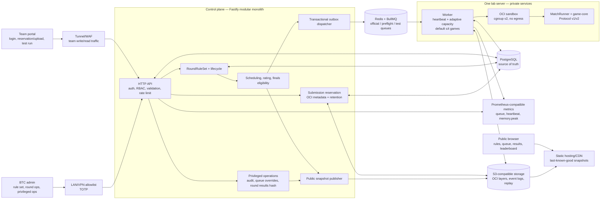
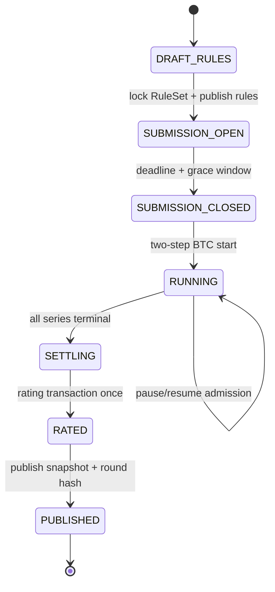
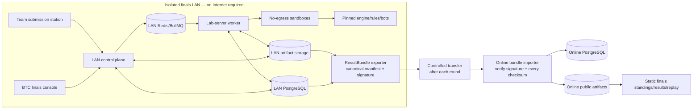

# Solution Architecture — Phase 3 hosted PoC và finals

> **Trạng thái:** Accepted baseline; `P3-T01` đã duyệt ngày 2026-10-14, implementation theo `tasks/todo.md`.
>
> **Ngày:** 2026-10-14
>
> **Baseline hiện có:** [Solution Architecture Phase 2 local](solution-architecture-phase-2.md).
>
> **Nguồn yêu cầu:** [Đặc tả yêu cầu v0.5](../tai-lieu-yeu-cau.md), [plan Phase 3](../../tasks/plan.md),
> [task checklist](../../tasks/todo.md), [phân công Phase 1–3](../team-assignment.md).

Tài liệu này mô tả kiến trúc PoC đã duyệt và phải đọc cùng ADR-0008–0010 cùng các contract Phase 3. Nó
không xác nhận implementation đã hoàn tất; chỉ `tasks/todo.md` có quyền quyết định trạng thái task/checkpoint.

## 1. Mục tiêu và phạm vi

Phase 3 mở rộng nền tảng Phase 2 local theo hai release gate độc lập:

1. **P3-2B — Qualification PoC hosted-ready:** round theo tuần, rule set version hóa, Protocol v2,
   upload/test-run có backpressure, một server lab, public snapshot tĩnh, hardening và recovery.
2. **P3-F — Finals offline-ready:** chung kết qua LAN cách ly, submission finals được pin, scoring theo
   game adapter/nhánh 8 đội đã duyệt và đồng bộ kết quả có chữ ký lên trang online.

Giữ nguyên các nguyên tắc Phase 2:

- `@ott/game-core` là nguồn sự thật duy nhất cho luật/state/hash.
- Control plane là Fastify modular monolith; execution worker là process/deployment boundary riêng.
- PostgreSQL giữ transaction và lịch sử; Redis/BullMQ là queue/session/cache; S3-compatible storage giữ
  artifact immutable.
- Queue at-least-once nhưng finalization/rating/publication có hiệu ứng exactly-once bằng transaction,
  unique constraint và idempotency key.
- Bot không có Internet, Docker socket, host filesystem hoặc credential hạ tầng.

## 2. Ràng buộc kiến trúc

| Ràng buộc | Hệ quả kiến trúc |
| --- | --- |
| PoC khoảng 200 đội trên một server lab | Scheduler/worker có priority, heartbeat và admission control; mặc định 4 game đồng thời, tự giảm theo CPU/RAM |
| Khoảng 100 session, burst 50 upload/reservation | API trả queue position/`Retry-After`; official jobs ưu tiên và không drop submission/result |
| Khoảng 1.000 public viewers | Public site chỉ đọc snapshot tĩnh qua CDN/static hosting; không truy vấn trực tiếp DB/worker |
| Luật và quota đổi theo tuần | `RoundRuleSet` version hóa, bất biến sau `SUBMISSION_OPEN`, pin vào match/replay |
| Server lab là single point of failure | PostgreSQL/outbox là nguồn sự thật, BullMQ có persistence, backup ngoài server và quy trình restore/retry; HA ngoài PoC |
| Bot và người dùng có thể đối kháng | Validation, RBAC, audit append-only, TOTP/network allowlist ở hosted PoC/production và sandbox cgroup/no-egress |
| Finals không có Internet | LAN stack tự đủ control plane/worker/storage; online chỉ nhận signed `ResultBundle` sau mỗi vòng |

## 3. Kiến trúc qualification mục tiêu

Public browser không có đường nối tới API/DB/worker trong read path bình thường. Snapshot publisher là
producer duy nhất của public payload; CDN/static hosting giữ bản cuối cùng khi control plane tạm mất kết nối.

## 4. Ranh giới component và source target

| Component | Source hiện có / target | Trách nhiệm Phase 3 | Không được làm |
| --- | --- | --- | --- |
| Game engine | `src/game-core` | Chạy engine version đã pin; giữ deterministic | Đọc DB/queue/cgroup hoặc tự chọn quota |
| Bot protocol | `src/bot-protocol` | Song song v1/v2; time budget, opaque identity và per-bot HMAC `botSeed` | Gửi `engineSeed`, biết opponent identity hoặc storage credential |
| Match runtime | `src/match-runner` | Chess-clock/dynamic timing, versioned game-result adapter, event/replay compatibility | Pairing, Elo hoặc persistence tournament |
| Shared jobs | `src/platform/job-contract` | Versioned official/preflight/test payload và immutable refs | Import Fastify/BullMQ runtime |
| Control plane | `src/platform/api` | Round lifecycle, reservation, auth hardening, ops, finals và snapshot publisher | Spawn bot hoặc tin authorization từ client |
| Execution plane | `src/platform/worker` | Priority/heartbeat/capacity, sandbox metrics, test/official jobs | Tự quyết định pairing/rating/finals advancement |
| Portal/admin UI | `src/platform/web` | Team/BTC authenticated workflows | Tự enforce RBAC hoặc giữ plaintext credential |
| Public static app | target trong `src/platform/web` | Đọc snapshot versioned/checksummed, hiển thị stale state | Gọi DB, worker hoặc API write |
| Ops/deployment | target `ops/`, `deploy/lan/`, `scripts/` | Metrics, backup/restore, LAN topology, rehearsal | Chứa production secret trong repository |

Không tạo service mới chỉ vì module mới xuất hiện. Ranh giới modular monolith của ADR-0005 được giữ cho
tới khi load/security evidence chứng minh cần tách process hoặc ownership độc lập.

## 5. State machine và luồng qualification

### 5.1 Round lifecycle

Invariants:

- `RoundRuleSet` tạo version mới khi sửa; từ `SUBMISSION_OPEN` trở đi là immutable.
- `START` chỉ chạy sau `SUBMISSION_CLOSED`, có reason/audit và idempotency key.
- Pause ngừng nhận job mới; job đang chạy được phép hoàn tất.
- Snapshot submission/rating/schedule seed đóng băng trước enqueue; worker order không đổi pairing/Elo.
- `RATED` chỉ sau mọi series terminal; `PUBLISHED` phát snapshot/rule/result hash ra public channel.

### 5.2 Submission và test run

1. Browser tính SHA-256 và tạo `SubmissionReservation` trước deadline.
2. API áp dụng per-team/global concurrency; quá tải trả stable error + retry-after.
3. Archive hoàn tất trong grace window chỉ được nhận nếu hash khớp reservation.
4. Validator kiểm OCI structure/digest/entrypoint; preflight chạy sandbox ở priority thấp hơn official.
5. Layer được lưu theo digest; retention không xóa `ACTIVE`, official-pinned hoặc ba bản gần nhất.
6. Test run chỉ đấu bot BTC hoặc submission cùng đội, không tính Elo và bị dừng admission khi official round chạy.

Queue priority cố định: `official > preflight > test-run`. PostgreSQL schedule/outbox là lịch sử chính;
BullMQ phân phối việc và có thể redeliver. Không dùng Google Sheets làm source of truth.

### 5.3 Replay và public snapshot

- Qualification replay sau integrity check chỉ hai team trong match và BTC được đọc.
- Anonymous public replay chỉ dành cho finals đã import/verify và qua `STAGED → PUBLISHED`.
- Public snapshot gồm rule version, round state, queue progress/order/ETA, results, leaderboard, announcement,
  updated-at và checksum; không chứa seed, object key, stderr hoặc private replay URL.
- Browser polling có cache; nếu publisher lỗi, tiếp tục dùng last-known-good snapshot và hiển thị stale warning.

## 6. Kiến trúc finals offline và đồng bộ online

LAN và online không chia sẻ database, queue hoặc writable object store. Đồng bộ là một chiều bằng
`ResultBundle` versioned theo [contract v1](../contracts/finals-result-bundle-v1.md):

- export gồm standings, results, event logs và canonical manifest;
- manifest canonical RFC 8785, ký Ed25519; private key ở offline, online chỉ giữ allowlisted public key;
- thiếu file, sai checksum hoặc sai chữ ký làm từ chối toàn bundle;
- import lại cùng bundle là idempotent; correction dùng version mới, reason và audit;
- public finals UI không tự tính bracket/tie-break/advancement và hiển thị bundle/key/checksum/import time/`VERIFIED`.

Finals có 8 đội, không bảng, single-elimination BO3; bronze match mặc định bật nhưng cấu hình được. Default
PoC là 200 lượt/game và 30 phút/cặp; `FinalsRuleSet` cho BTC đổi trước khi lock. Versioned game adapter trả
ordered `scoreBreakdown`; qualification seed là fallback cuối để game luôn có winner.

## 7. Dữ liệu và invariant bổ sung

| Aggregate/entity | Invariant tối thiểu |
| --- | --- |
| `RoundRuleSet` | Version immutable; một version locked cho mỗi round; chứa engine/map/timing/resource/schedule/test policy |
| `SubmissionReservation` | `(team, round, hash)` unique; deadline/grace timestamp server-side; hash không đổi |
| OCI layer metadata | Digest content-addressed; reference count/retention transaction-safe; official-pinned layer không GC |
| `TestRun` | Owner team immutable; opponent allowlist; không tạo rating ledger |
| Worker registration | Heartbeat/lease/adaptive capacity versioned; stale/quá tải worker không nhận job mới |
| Public snapshot | Version/checksum/updated-at; last-known-good publish atomic |
| Privileged operation / audit | Audit append-only (trigger DB); mọi thao tác đặc quyền có actor, reason, correlation ID và before/after; không sửa result/ledger/audit lịch sử. Hồ sơ vụ việc (anomaly/duplicate/appeal) đã bỏ ở P3-D27 (2026-10-18): khiếu nại xử lý ngoài nền tảng (email/GitHub issues) |
| Finals bracket/series | 8 unique seeds; config/schedule immutable sau lock; advancement chỉ từ finalized results |
| `ResultBundle` | Bundle/version unique; manifest/signature/checksum verified trước transaction publish |

Mọi timestamp lưu UTC; UI hiển thị timezone của giải. Mọi privileged mutation có actor, reason,
correlation ID, before/after hoặc delta và idempotency key khi có thể retry.

## 8. Security và trust boundaries

| Boundary | Control Phase 3 |
| --- | --- |
| Public Internet → public site | Static only, CDN/WAF, CSP/HSTS/content-type/frame policy, no credential |
| Team Internet → API | Tunnel/WAF, schema/body/concurrency limit, account/IP rate limit, opaque session, team scope server-side |
| Admin → API | LAN/VPN allowlist, trusted-proxy validation, TOTP/recovery code, production fail-closed config |
| Upload → storage/worker | Reservation hash, quarantine, OCI allowlist, content digest, size/layer limit, protocol preflight |
| Worker → bot | cgroup v2, read-only rootfs, no swap/egress/socket, PID/tmp/output/time limits, process-tree cleanup |
| Metrics/log/audit | No password/session/source/private stderr; labels avoid unbounded sensitive values |
| LAN → online | RFC 8785 + Ed25519, checksum every file, all-or-nothing import; PoC có test key/manual transfer |

TOTP/network allowlist được phép tắt ở dev/test, nhưng hosted PoC/production phải từ chối start khi policy
không được cấu hình. Hành vi bắt buộc nằm tại [Platform Auth v2](../contracts/platform-auth-v2.md).

## 9. Availability, backup và observability

- Worker heartbeat/capacity quyết định admission; quá nhiệt/áp lực RAM/stale heartbeat ngừng nhận job mới.
- Hai bot của một match chạy cùng server; host benchmark/cpuset policy được pin vào capacity evidence.
- Backup PostgreSQL và artifact metadata ra ngoài server trước/sau round; restore cô lập phải được smoke-test.
- Metrics tối thiểu: queue depth/age theo priority, upload/preflight backpressure, heartbeat/capacity,
  attempt/retry/DLQ, infra-vs-bot fault, finalization/rating lag, cgroup CPU/RAM/`memory.peak`, snapshot age.
- Alert theo triệu chứng và gắn runbook; mất Internet không được làm mất match/result, chỉ làm public snapshot stale.
- AC-13/D-26 được kiểm bằng smoke/load vừa phải trên đúng server lab; không suy rộng thành SLA production.

## 10. Contract và decision gates

| Gate | Phải khóa trước implementation phụ thuộc |
| --- | --- |
| Protocol v2 | Approved by ADR-0008/Bot Protocol v2; schema/types/fixtures in `P3-L01` |
| Round control | D-14/D-17/D-18/D-19 accepted; lifecycle/RuleSet API in `P3-D01` |
| Rating/finals eligibility | D-22 accepted; Phase 2 ledger history remains reproducible |
| Authentication v2 | Approved policy contract; endpoint/schema implementation in `P3-D04`/`P3-D06` |
| Replay/public snapshot | Qualification private from first data; no legacy public migration; D-21/D-25 accepted |
| Finals format | Locked by Finals Format v1; implementation in `P3-L06`/`P3-D08` |
| Result bundle | Ed25519 + RFC 8785 locked by ResultBundle v1; implementation in `P3-D09` |

Các ADR-0008–0010 ghi lại quyết định đã duyệt; task implementation vẫn phải bổ sung machine schema, fixture,
test và docs trong đúng branch, không được coi ADR tồn tại là bằng chứng code đã hoàn tất.

## 11. Delivery map và checkpoint

| Architecture slice | Tasks | Gate |
| --- | --- | --- |
| Protocol/rules/resource foundation | `P3-L01`, `P3-D01`, `P3-N01` | `P3-A` |
| Timing/single-host admission/admin operations | `P3-L02`, `P3-N02`, `P3-D02` | `P3-B` |
| Reservation/bulk account/test run | `P3-D03`, `P3-D04`, `P3-N03` | `P3-C` |
| OCI/rating/replay privacy | `P3-N04`, `P3-L03`, `P3-D05` | `P3-D` |
| Replay/public snapshot/auth hardening | `P3-L04`, `P3-L05`, `P3-D06` | `P3-E` |
| Operations/single-server smoke-load/pilot | `P3-N05`, `P3-D07`, `P3-N06` | `P3-2B` |
| Finals domain/LAN control | `P3-L06`, `P3-D08`, `P3-N07` | `P3-F1` |
| Signed sync/public finals/rehearsal | `P3-D09`, `P3-D10`, `P3-N08` | `P3-F` |

Không bắt đầu finals implementation trước `P3-2B`. Không deploy online hoặc LAN chỉ vì `P3-F` plan tồn tại;
Đinh Đức Thuận phải duyệt checkpoint và yêu cầu deploy riêng.

## 12. Deferred productionization decisions

- Provider cụ thể cho static hosting/CDN/tunnel và domain/TLS operations được chọn khi deploy, không được
  hard-code vào domain contract.
- Năng lực vượt target PoC, multi-worker host/pool, HA/DR SLA và 24/7 monitoring cần measurement + ADR mới.
- HSM, automated key rotation/revocation service và automated LAN→online transfer nằm ngoài PoC.
