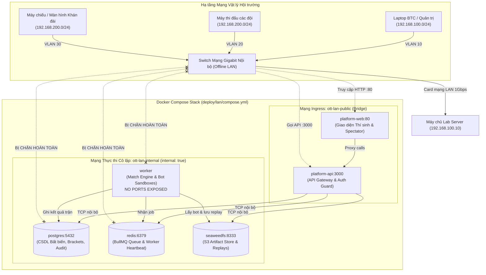

# Sổ tay Vận hành & Triển khai LAN Vòng Chung kết (Finals LAN Runbook) — P3-N07

**Chủ sở hữu:** Đỗ Khôi Nguyên (Owner lane `P3-N*` — Sandbox / Worker / Operations Readiness)  
**Phạm vi áp dụng:** Ban tổ chức (BTC), Kỹ sư hạ tầng, Trọng tài vận hành giải đấu chung kết OTT.  
**Mục tiêu:** Quy định chuẩn mực triển khai hệ thống offline hoàn toàn không Internet trên máy chủ lab duy nhất, cách ly mạng đội thi khỏi worker, kiểm soát tạm dừng an toàn (`pauseAdmission`), xử lý sự cố worker và diễn tập khôi phục dữ liệu tại chỗ cho **Checkpoint P3-F1**.

---

## 1. Kiến trúc Mạng & Topology LAN Cô lập (Network Topology & Isolation)

Hệ thống thi đấu vòng chung kết được thiết kế để vận hành trên một máy chủ lab duy nhất (Single-Server Local Stack) trong điều kiện **ngắt hoàn toàn kết nối Internet/WAN (Zero-Internet, No-Egress Policy)**.

### Sơ đồ Topology Hai Lớp Mạng (Mermaid)



### Nguyên tắc Cách ly Bất biến (Security & Isolation Invariants)

1. **No-Egress & Zero-Internet:**
   - Network `ott-lan-internal` được cấu hình `internal: true`. Docker tự động ngăn chặn tạo default route ra ngoài, vô hiệu hóa hoàn toàn mọi outbound packet đến Internet.
   - Cáp mạng WAN/Internet của server lab và switch thi đấu bắt buộc phải được rút vật lý trước giờ thi đấu.
2. **Worker Unreachability (Cô lập Worker Tuyệt đối):**
   - Container `worker` chỉ gắn duy nhất vào network `ott-lan-internal`.
   - `worker` không bind bất kỳ cổng TCP/UDP nào ra host (`ports` block hoàn toàn vắng mặt).
   - Thí sinh trên VLAN 20 không thể ping, quét cổng hoặc can thiệp vào tiến trình thực thi sandbox của worker.
3. **Internal Data Plane Isolation:**
   - CSDL `postgres`, hàng đợi `redis` và object storage `seaweedfs` chỉ mở cổng nội bộ bên trong `ott-lan-internal`, không mở cổng ra card mạng vật lý của lab server.

---

## 2. Checklist Chuẩn bị Hạ tầng Server Lab (Pre-flight Setup)

### 2.1. Yêu cầu Cấu hình Phần cứng & Hệ điều hành
- **CPU:** Tối thiểu 8 cores (khuyến nghị 16 cores).
- **RAM:** Tối thiểu 32 GB.
- **Ổ cứng:** Tối thiểu 256 GB NVMe SSD tốc độ cao.
- **Hệ điều hành:** Linux Ubuntu 24.04 LTS (hoặc Windows Server 2022 với Docker Engine 27+ và WSL2/Hyper-V).
- **Phần mềm bắt buộc:**
  - Node.js `v22.12.0` trở lên (`node -v`).
  - Docker Engine `27.x` và Docker Compose `v2.x` (`docker compose version`).

### 2.2. Cấu hình Mạng LAN & Local NTP Server
1. **Thiết lập IP tĩnh cho Server Lab:**
   - IP: `192.168.100.10`
   - Subnet Mask: `255.255.0.0` (/16)
   - Gateway: Để trống (không có gateway ra ngoài).
2. **NTP Đồng bộ Giờ Cục bộ (Local NTP):**
   - Trong môi trường offline, chạy dịch vụ `chrony` hoặc Windows Time Service nội bộ trên lab server để làm nguồn cấp thời gian cho toàn hội trường.
   - Cấu hình các máy trạm đội thi đồng bộ NTP về `192.168.100.10` để log thi đấu khớp đến từng miligiây.

---

## 3. Quy trình Triển khai LAN Stack (Deployment Procedure)

### Bước 1: Chuẩn bị Biến Môi trường
Sao chép template cấu hình offline:
```bash
cp deploy/lan/.env.example deploy/lan/.env
```
Kiểm tra và điền các giá trị bí mật cục bộ trong `deploy/lan/.env`:
- `OTT_DEPLOYMENT_MODE=finals_lan`
- `OTT_ADMIN_NETWORK_ALLOWLIST=192.168.100.0/24,127.0.0.1/32`
- `OTT_BOOTSTRAP_BTC_TOTP_SECRET`: Khóa Base32 TOTP cho tài khoản Quản trị BTC.
- Mật khẩu PostgreSQL, Redis và S3.

### Bước 2: Khởi động Dịch vụ Docker Compose
```bash
docker compose -f deploy/lan/compose.yml up -d
```

### Bước 3: Di chuyển Lược đồ CSDL (Migrations)
Áp dụng toàn bộ migration từ `0001_initial` đến `0017_result_bundles`:
```bash
npm run db:migrate --workspace @ott/platform-api
```
Kiểm tra tính toàn vẹn thứ tự migration:
```bash
npm test --workspace @ott/platform-api -- migrations-registry
```

### Bước 4: Kiểm tra Khởi động Khói Tự động (Smoke Verification)
Chạy script kiểm tra khói chuyên dụng cho LAN:
```bash
bash scripts/lan-smoke.sh
```
Script sẽ tự động xác minh:
- [x] File `compose.yml` có `internal: true` cho `ott-lan-internal`.
- [x] Service `worker` không mở cổng ra ngoài và chỉ nằm trong mạng nội bộ.
- [x] CSDL Postgres, Redis, SeaweedFS không công khai cổng ra host.
- [x] Không phát hiện luồng mạng ra Internet (No-Egress test).

---

## 4. Quy trình Điều phối Vận hành & Tạm dừng An toàn (`pauseAdmission`)

### 4.1. Giám sát Năng lực Worker (Adaptive Capacity & Heartbeat)
- Worker định kỳ phát heartbeat mỗi 5 giây vào Redis key `ott:worker:heartbeat:<worker_id>`.
- Heartbeat payload bao gồm: `capacity`, `activeCount`, `cpuPercent`, `memoryPercent`, `paused`, `timestamp`.
- Worker tự động điều chỉnh concurrency (từ 1 đến 4 trận song song) tùy thuộc vào tải CPU và áp lực RAM của lab server nhằm đảm bảo độ chính xác của bot execution timer.

### 4.2. Kịch bản Tạm dừng Khẩn cấp (Safe Admission Pausing)
Khi có sự cố kỹ thuật tại bàn thi đấu (ví dụ: máy đội thi gặp sự cố phần cứng, trọng tài cần hội ý hoặc xử lý khiếu nại):

1. **Kích hoạt Tạm dừng Tiếp nhận Trận đấu:**
   - Trọng tài điều hành gửi lệnh pause thông qua API hoặc bảng điều khiển `/admin/operations`:
   ```bash
   # Gửi tín hiệu tạm dừng tiếp nhận job mới
   POST /api/v1/admin/operations/pause-admission
   Body: { "reason": "FINALS_TECHNICAL_TIMEOUT_MATCH_3" }
   ```
2. **Cơ chế Xử lý của Hệ thống:**
   - Worker chuyển cờ `paused = true` trong heartbeat payload.
   - **Các trận đang chạy dở (in-flight):** Tiếp tục thi đấu đến khi hoàn tất bình thường; hệ thống KHÔNG hủy ngang trận đang chạy.
   - **Các trận kế tiếp trong nhánh:** Tự động hoãn lại (`DELAYED`) trong hàng đợi BullMQ, giữ nguyên thứ tự hạt giống và dữ liệu, tuyệt đối không bị drop mất job.
3. **Khôi phục Thi đấu (Resume Admission):**
   - Sau khi sự cố được khắc phục, quản trị viên mở lại tiếp nhận:
   ```bash
   POST /api/v1/admin/operations/resume-admission
   ```
   - Worker khôi phục cờ `paused = false` và tự động kéo các trận đang hoãn về thực thi ngay lập tức.

---

## 5. Sổ tay Ứng phó Sự cố & Phục hồi Cục bộ (Local Disaster Recovery)

### Sự cố 1: Worker Process Crash hoặc Treo
- **Triệu chứng:** Worker không cập nhật heartbeat quá 15 giây (`WorkerHeartbeatMissing`).
- **Xử lý Tự động:**
  - Hết hạn lease match.
  - Bộ điều phối tự động tăng `generation` trong `match_outbox` để hủy bỏ quyền ghi kết quả muộn của worker cũ.
- **Thao tác Vận hành:**
  ```bash
  docker compose -f deploy/lan/compose.yml restart worker
  ```
  - Worker mới khởi động lại, đăng ký heartbeat mới, nhận job theo `generation` mới và thi đấu an toàn.

### Sự cố 2: Đấu lại Trận đấu (Rerun Protocol / AC-3)
- **Quy tắc Bất di Bất dịch:** Rerun CHỈ ĐƯỢC PHÉP cho sự cố hạ tầng kỹ thuật (`INFRA_FAILURE_REASONS`):
  - `MATCH_LEASE_EXPIRED` (quá hạn lease do hạ tầng)
  - `MATCH_EXECUTION_FAILED` (lỗi hệ thống thực thi)
  - `SANDBOX_NOT_RUNNING` (container daemon gặp lỗi)
  - `STORAGE_UNAVAILABLE` (lỗi truy xuất lưu trữ)
- **Tuyệt đối Bác bỏ Rerun đối với:**
  - Lỗi code của thí sinh: `BOT_TIMEOUT`, `ILLEGAL_ACTION`, bot crash do ngoại lệ nội bộ.
  - Các trận đấu thuộc vòng/nhánh đã kết thúc (`FINALIZED` / `hasRatingLedger: true`).
- **Chống Trùng lặp (Idempotency Guarantee):**
  - Khi trận đấu rerun hoàn tất, hệ thống đối soát theo `generation`.
  - Kết quả từ các tiến trình cũ hoặc các gói tin gửi muộn bị hủy bỏ tức thì (`STALE_OR_DUPLICATE_GENERATION_IGNORED`), bảo đảm nhánh đấu chỉ tiến bước 1 lần duy nhất và không bị cộng dồn số trận thắng/thua.

### Sự cố 3: Máy chủ Lab Sập Nguồn & Diễn tập Khôi phục Toàn vẹn (Disaster Recovery Drill)
1. **Sao lưu Trước Mỗi Vòng đấu:**
   ```bash
   bash scripts/backup-local.sh
   ```
   - Script tạo thư mục backup chứa dump CSDL PostgreSQL (`backup_*.sql.gz`), toàn bộ artifact SeaweedFS (`storage_*.tar.gz`) và file manifest SHA-256 (`manifest.sha256`).
2. **Khôi phục khi Thay thế Máy chủ Khác:**
   ```bash
   bash scripts/restore-local.sh <path_to_backup_directory>
   ```
   - Script tự động nạp lại CSDL, giải nén artifact và đối soát lại SHA-256 manifest.
   - Xác thực: Toàn bộ bảng xếp hạng, nhánh đấu 8 đội, tài khoản các đội và log replay được khôi phục nguyên trạng 100%.

---

## 6. Biên bản Nghiệm thu Checkpoint P3-F1 (Verification & Sign-off)

| STT | Hạng mục Kiểm tra Nghiệm thu | Phương pháp Xác minh | Kết quả |
| :---: | :--- | :--- | :---: |
| 1 | **Topology Mạng Không Internet** | Chạy `bash scripts/lan-smoke.sh`, kiểm tra `internal: true` | [x] ĐẠT |
| 2 | **Cô lập Tuyệt đối Worker** | Kiểm tra `worker` không có port mapping, unreachable từ VLAN 20 | [x] ĐẠT |
| 3 | **Worker Heartbeat & Năng lực Tải** | Chạy `tests/e2e/lan-recovery.test.ts`, kiểm tra adaptive capacity | [x] ĐẠT |
| 4 | **Tạm dừng An toàn `pauseAdmission`** | Kiểm tra hoãn job an toàn không drop dữ liệu khi pause | [x] ĐẠT |
| 5 | **Rerun Hạ tầng & Chống Ghi đúp** | Kiểm tra chỉ cho phép infra failure, chặn đúp bracket/Elo | [x] ĐẠT |
| 6 | **Diễn tập Sao lưu & Khôi phục** | Kiểm tra đối soát SHA-256 checksums trước và sau restore | [x] ĐẠT |

**Xác nhận Ký duyệt Checkpoint P3-F1:**
- **Người thực hiện:** Đỗ Khôi Nguyên (Kỹ sư Trưởng Hạ tầng & Vận hành)
- **Người phê duyệt:** Đinh Đức Thuận (Trưởng Ban Kỹ thuật Giải đấu OTT)

